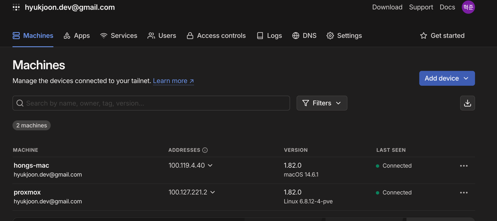
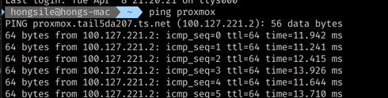
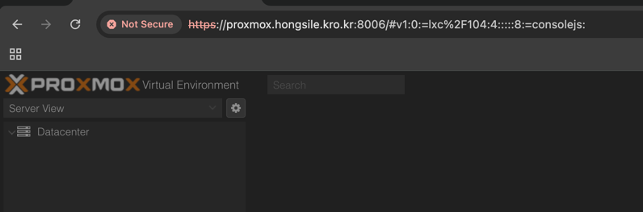

# 홈서버 개발기 - 2

## 원격 접속

홈서버를 만들고 나서 세팅해야 할 것들이 많지만, 가장 먼저 해야 할 것은 원격 접속 환경을 구성하는 것입니다. 
보통은 SSH를 사용해서 원격으로 접속하게 되는데, 여기서 주의할 점이 있습니다.

예전에 홈서버를 운영했을 때엔 아무 생각 없이 SSH의 기본 포트인 22번을 열어두고 운영했던 적이 있었습니다.  
하지만 몇 시간 지나지 않아 수많은 로그인 시도 로그가 쌓이기 시작했습니다.  

AWS EC2 인스턴스를 사용할 때도 마찬가지였는데, 보안 그룹에서 22번 포트를 열어두자마자 중국, 러시아 등 전 세계에서 무작위로 접속을 시도하는 로그가 찍히기 시작했습니다.

비밀번호 인증을 꺼두고 공개키 인증만 사용했기 때문에 침입은 없었지만, 매초 수십 개의 로그가 찍히는 상황은 신경이 쓰일 수밖에 없었습니다. 이 경험을 통해, 단순히 포트 번호를 바꾸는 것(Port 2222 같은
방식)만으로는 충분하지 않다는 것을 깨달았습니다.

이번에 서버를 만들 때엔 그런 리스크를 지고 싶지 않았고, 다른 대안을 찾기 시작했습니다.

## Tailscale

장소에 구애받지 않고, 내 기기만 서버에 접속을 가능하게 하고 싶다? 그러면 가장 합리적인 방안은 VPN입니다.
VPN은 공용 인터넷 상에서 사설 네트워크에 접속할 수 있도록 만들어주는 기술로, 마치 같은 로컬 네트워크에 있는 것처럼 서버에 접근할 수 있게 해줍니다. 

수많은 VPN 서비스들이 있지만, 그 중에서도 저는 tailscale을 사용했습니다.

일반적인 VPN 서비스(OpenVPN, SoftEther 등)는 설정이 복잡하고, 서버를 따로 운영해야 하거나 포트포워딩, 방화벽 설정 같은 번거로운 작업이 필요합니다. 

반면, Tailscale은 이런 과정 없이도 설치 후 로그인만 하는 것으로 사용할 수 있습니다.  
사실 이것이 가장 큰 장점입니다. 사이트에서 회원가입하고 난 뒤엔 vpn 연결할 곳에서 tailscale 프로그램 실행시키고 로그인만하면 끝이거든요.

그리고 웹사이트에서 이렇게 연결되어있는 머신들과 연결 여부, 그리고 실제 vpn 내부의 ip까지 볼 수 있었습니다.

또 tailscale에서는 magic dns라는 것이 있습니다.  vpn 내부에서만 사용할 수 있는 도메인 이름을 지정할 수 있죠.
보통 100.100.100.100이 tailscale의 dns 주소입니다.

예를 들어서, 위 화면에서 proxmox로 접속하려면  
http://proxmox.tailnet-name.ts.net
이렇게 접근할 수 있습니다.(tailnet-name은 계정마다 다릅니다.)

심지어 /etc/resolv.conf에 다음과 같은 라인이 추가되어서 본인이 등록한 machine의 이름만 알고 있으면 접근이 가능하죠.

`search {tailnet-name.ts.net}`
이런게 resolv.conf에 붙어있으면 dns에 질의할 떄 해당 search 뒤에 있는 내용을 postfix로 붙여서 질의해줍니다.

그리고 dns가 이미 있기 때문에, 간단하게 본인이 소유한 도메인에 CNAME으로 이를 등록하면 쉽게 붙여서 사용할 수 있죠. 

~~https는 다음 기회에 설정하면서 붙이려고 합니다.~~

## 트러블 슈팅 - lxc

proxmox에 tailscale로 vpn 구축을 하고 난 뒤에 이상한 일이 생겼습니다. 
생성한 lxc 노드들에서 외부로 요청이 안되는 것이었습니다. apt 도 아무것도 안되어서 당황했었죠.

디깅을 몇번 하다가 문제를 알아 냈는데, lxc 컨테이너로 생성된 노드의 dns 설정파일인 resolv.conf가 이상했습니다.
100.100.100.100과 search `search {tailnet-name.ts.net}`밖에 없었죠.

바라보는 dns가 tailscale의 magic dns 주소죠. 생성된 lxc 노드가 tailscale에 연결된 상태였다면 문제가 없이 동작했겠지만 
그렇지 않기 때문에 도메인 네임을 못 받아왔던 것이었습니다.

상단에 global dns 주소 추가해주고 나서 이 문제는 해결되었습니다.
proxmox resolv.conf에서도 global dns주소를 추가해주는 것으로 이 문제는 일단락되었습니다.

