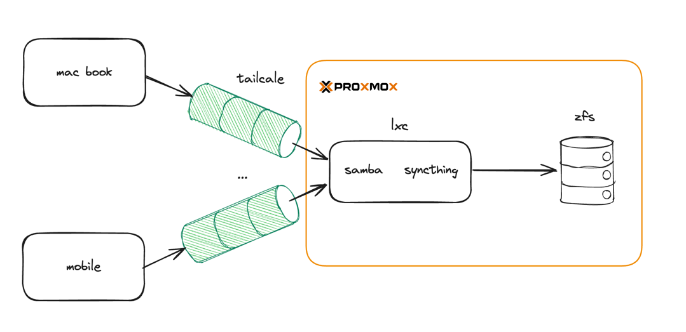

# 홈서버 구축기 - 6(파일 서버 구축)

## 목적

기존에는 Obsidian Vault를 Google Drive에 업로드하고, Drive Sync 프로그램을 통해 여러 장비에서 동기화하며 사용해 왔습니다.

하지만 노트 수가 많아지면서 Google Drive의 용량이 부족해졌고, Drive Sync 역시 자주 오류를 일으켜 안정적인 사용에 어려움이 있었습니다.

이제는 홈서버를 직접 운영하게 되면서, Obsidian Vault를 홈서버에 올려 직접 관리하려고 합니다. 
직접 관리하면서 용량 제약 없이 파일을 관리하고 추후에 다른 서비스들과 다양한 방식으로 연동하는 것을 목표로 합니다.

## 파일 서버 구축

그럼 파일 서버를 구축해야 하는데, 아래와 같은 생각들이 있어서, 적절한 리소스를 선택해야 합니다.

- vm을 띄워서 돌아가는 서비스는 x
    - 홈서버 리소스가 아직은 많지 않고, 아직은 옵시디언 볼트만 관리할 예정
- 다양한 기기에서 문제 없이 동작해야 한다.
    - 현재 개인 맥북뿐 아니라 핸드폰에서도 사용하고 있어서 플랫폼에 제약이 덜 했으면 하는 생각
- 인증은 vpn(tailscale)으로
    - 현재 접근할 기기들은 전부 개인 기기들이고 옵시디언 볼트는 공개할 생각이 없기 때문에 vpn 연결된 기기만 사용
    - 또한 tailscale은 p2p 형식이기 때문에 속도적인 측면에서도 이점이 있을 것으로 생각

위와 같은 요구사항을 만족하기 위해서 다양한 방법들을 찾아봐야했습니다.

### ZFS vs NAS

가장 먼저 파일을 어떻게 저장하고 관리할 것인지에 대해 여러 방법을 찾아보고 고민했습니다.
대표적으로는 아래 두 가지 방식이 있었습니다

- ZFS를 직접 구성하여 관리하는 방식
- NAS 운영체제(예: TrueNAS, OMV)를 사용하는 방식

ZFS는 무결성 검사, 스냅샷, 압축, 복구 등의 기능을 갖춘 파일 시스템이자 볼륨 매니저로, Vault와 같은 중요한 데이터를 저장하는 데 적합합니다.  
또한 Proxmox 호스트에서 직접 구성할 수 있어 VM 없이도 안정성과 성능을 확보할 수 있습니다.

반면 NAS OS(예: TrueNAS, OMV)는 UI 기반 관리와 다양한 기능을 제공하지만, VM에서 구동되는 경우 리소스를 많이 차지합니다.

현재 홈서버 리소스가 제한적이기 때문에, ZFS를 호스트에서 직접 운영하고 파일 서버는 LXC 수준에서 구성하는 것이 최적이라고 판단했습니다.

또한, 현재는 ZFS를 직접 구성하여 운영하되, 서버의 하드웨어 자원을 늘리면 추후 필요에 따라 ZFS에 있는 데이터를 OMV 등의 NAS 운영체제에서 마운트하여 관리하는 것도 가능하기 때문에
일단 zfs로 구성하는 방안을 생각했습니다.

### WebDAV vs Samba vs Syncthing

WebDAV는 모바일 Obsidian 앱에서 연동이 가능하다는 장점이 있지만, 실시간 편집이나 파일시스템 마운트 측면에서 성능이 떨어집니다. 
Samba는 네트워크 드라이브처럼 마운트되어 macOS 등에서 실시간 편집에 유리하며, 
Syncthing은 모든 장치에 Vault를 복제해 네트워크가 단절되더라도 오프라인에서 작업이 가능하고 충돌 방지 기능도 내장되어 있어 백업 및 복구 측면에서 강점이 있습니다.

결론적으로, 현재 목적(맥북에서 실시간 작업 + 모바일 연동 + 백업/복구 대비)을 고려했을 때, Samba로 주 작업 환경을 구성하고 Syncthing으로 다른 기기와 동기화하는 전략이 가장 적절하다고 판단했습니다.

## 최종 설계

- Vault는 proxmox 호스트의 ZFS 풀(vault-pool/obsidian)에 저장하여 무결성과 안정성을 확보
- LXC 컨테이너 내에 Samba 서버를 구성하여 맥북에서 네트워크 드라이브처럼 마운트
- Syncthing을 사용해 모바일 및 노트북 등 다른 장비와 실시간 동기화
- 모든 연결은 Tailscale VPN을 통해 이루어지며, 인증된 개인 장치에서만 접근 가능

대략적으로 위 그림처럼 동작할 것입니다.

## zfs on proxmox
